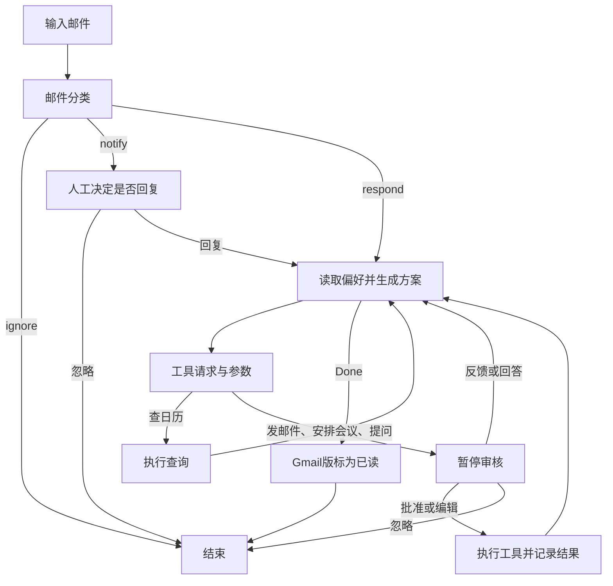

# MailFlow Agent｜邮件智能体学习项目

我用这个项目学习把大模型接入实际邮件工作流：让助手判断邮件是否需要处理、生成工具调用，并在发送邮件或创建会议前暂停，由我审核。

目前已完成主要模块的学习：基础 Agent、评估、人工审核、偏好记忆和 Gmail 集成。项目使用 LangGraph 编排、DeepSeek 分类与生成、LangSmith 追踪与评估。我已经实际跑通一封专用测试邮件的完整流程：**读取 Gmail → 分类 → 生成回复 → 人工批准 → 真实发送 → 原邮件标为已读**。

仓库同时保留模拟版与 Gmail 版：Notebook 适合拆解原理，Gmail 工作流用于真实 API 实验。日历、自动采集和定时任务的代码已整理，但不能因此视为所有真实场景或生产部署已经验证。

## 我完成的内容

- 邮件分流：respond、notify、ignore 对应不同处理路径。
- DeepSeek 适配：集中管理模型配置、结构化输出、工具调用与非 thinking 模式。
- 评估：工具调用检查、邮件分类和回复质量评估。
- 人工审核：接受、编辑、反馈、忽略；缺失信息通过 Question 向用户询问。
- 审核恢复：统一校验恢复值，非法输入时重新暂停；Gmail 版也复用此处理。
- 偏好记忆：从编辑或文字反馈更新分类、回复、日历偏好，在不同线程读取同一 Store。
- Gmail OAuth：理解应用凭据、用户授权、权限范围、访问与刷新令牌。
- 真实邮件闭环：通过 Studio 批准后发送回复，核实已发送记录与已读标签。
- 工具与采集：整理 Gmail/Calendar 工具、Gmail 输入字段、采集脚本及服务端线程/运行的关系。
- 手工测试：按主题精确提交单封测试邮件，检查状态、当前偏好和真实发送结果；准备 11 组通用用例。

## 工作流程



模型生成工具参数不是执行工具。accept 执行原方案；edit 执行完整的修改后参数，再更新相应偏好；response 先反馈并更新偏好，再生成新方案等待审核。Question 的回答进入当前线程，这个分支不直接更新长期偏好。分类 ignore 直接结束，当前不会自动标为已读。

## 代码与学习材料

- `notebooks/agent.ipynb`、`evaluation.ipynb`、`hitl.ipynb`、`memory.ipynb`：基础、评估、人工审核和记忆实验；不包含运行输出。
- `src/email_assistant/email_assistant.py`：基础助手。
- `src/email_assistant/email_assistant_hitl.py`：人工审核版。
- `src/email_assistant/email_assistant_hitl_memory.py`：偏好记忆版。
- `src/email_assistant/email_assistant_hitl_memory_gmail.py`：真实 Gmail 工作流。
- `src/email_assistant/models.py`、`human_review.py`：模型配置与审核校验。
- `src/email_assistant/tools/gmail/`：授权、读取检查、真实工具、采集及手工测试入口。
- `src/email_assistant/cron.py` 与 Gmail 目录的 `setup_cron.py`：未启用的定时获取参考入口。
- [Gmail 配置与运行](src/email_assistant/tools/gmail/README.md)。
- [11 组手工测试步骤与邮件模板](docs/GMAIL_MANUAL_TEST_GUIDE.md)。
- [从学习项目到个人日常助手的计划](docs/IMPLEMENTATION_ROADMAP.md)。

## 安装和模型配置

推荐 Python 3.11，支持 `>=3.11,<3.14`。克隆后，在项目根目录的 PowerShell 中执行：

```powershell
py -m pip install uv
py -m uv python install 3.11
py -m uv sync --python 3.11 --extra dev --locked
```

PyCharm 和 Notebook 都选择本项目的 `.venv\Scripts\python.exe`。首次配置时复制空模板，已有 `.env` 不要覆盖：

```powershell
Copy-Item .env.deepseek.example .env
```

在本地填写 DeepSeek 密钥。模型默认值可按账户支持情况调整，需要支持项目使用的工具调用和非 thinking 参数。LangSmith 追踪默认关闭；需要追踪/评估时，在本地配置密钥、项目名以及必要的服务区域端点。

```powershell
.\.venv\Scripts\python.exe -X utf8 run_demo.py
```

以上是模拟工具的基础演示，不会发送真实邮件。

## Gmail：从授权到人工发送

先按 [Gmail 配置说明](src/email_assistant/tools/gmail/README.md) 启用 API、创建桌面 OAuth 客户端，在本地放置 `.secrets/secrets.json`，运行授权并检查测试邮件读取：

```powershell
.\.venv\Scripts\python.exe -X utf8 src/email_assistant/tools/gmail/setup_gmail.py
.\.venv\Scripts\python.exe -X utf8 src/email_assistant/tools/gmail/check_gmail_read.py
```

Google 授权与 DeepSeek 密钥是两套配置。授权文件、令牌和 `.env` 均不提交。读取检查默认找主题 `MailFlow-Read-Test` 的邮件，不调用模型、不发送、不修改标签。

启动只加载 Gmail 工作流的本地服务，并保持终端开启：

```powershell
$env:PYTHONUTF8 = '1'
.\.venv\Scripts\python.exe -X utf8 -m langgraph_cli dev --config langgraph.gmail.local.json --no-browser --no-reload --allow-blocking
```

先访问 `http://127.0.0.1:2024/ok`，再打开启动信息中的 Studio 链接。全模块开发配置是 `langgraph.json`；注册 cron 图并不等于创建了定时任务。

从另一个自己的邮箱给已授权 Gmail 发测试邮件，主题以 `MailFlow-Test-` 开头。替换下方两个示例地址，在另一个终端提交指定邮件：

```powershell
$senderEmail = 'sender@example.com'
$assistantEmail = 'assistant@example.com'
.\.venv\Scripts\python.exe -X utf8 src/email_assistant/tools/gmail/manual_test.py submit --subject MailFlow-Test-01-Edit --sender $senderEmail --recipient $assistantEmail
```

在脚本输出的线程链接中查看生成结果。原始 Resume 输入框完整填写 JSON，然后点击 Resume：

```json
[{"type":"accept"}]
```

这会真正执行当前动作。给修改意见则填写 response，并在新方案出现后再次审核：

```json
[{"type":"response","args":"Please make this reply shorter and less formal."}]
```

Studio 的 JSON 输入与 Agent Inbox 的文字反馈框不同；Question 通常只允许 response/ignore。Agent Inbox 可使用本地服务地址与图名 `email_assistant_hitl_memory_gmail` 连接。发信、建会前核对当前 action 和参数；修改邮件文案不会自动修改已创建会议。

检查任务、实际发送和记忆：

```powershell
.\.venv\Scripts\python.exe -X utf8 src/email_assistant/tools/gmail/manual_test.py status --subject MailFlow-Test-01-Edit
.\.venv\Scripts\python.exe -X utf8 src/email_assistant/tools/gmail/manual_test.py verify --subject MailFlow-Test-01-Edit
.\.venv\Scripts\python.exe -X utf8 src/email_assistant/tools/gmail/manual_test.py memory --save after-first-test
```

辅助脚本精确匹配单封邮件；同一主题重复提交只返回已有线程。运行记录与记忆快照保存在被忽略的 `.local-backups/`。它不会自动接受审核。详细邮件模板、edit 参数和预期结果见手工指南。

## 记忆与线程

checkpointer 按 LangGraph thread_id 保存执行状态；Store 用 namespace 和 key 保存供不同线程读取的偏好。当前三类 profile 是 triage_preferences、response_preferences、cal_preferences，key 为 user_preferences。

`get_memory()` 不存在时初始化；`update_memory()` 将旧 profile 与反馈交给模型，生成完整新文本后覆盖同一条记录。这不是训练模型参数。接受动作本身不更新偏好；忽略动作会更新分类偏好，其推断是否过度需要检查。

Notebook 使用 InMemorySaver/InMemoryStore，重启内核会丢失内存数据；开发服务管理自己的 `.langgraph_api`，不会自动使用 Notebook 的对象。Gmail thread 表示邮件往来，LangGraph thread 表示工作流状态，二者不能混为一谈。

Studio Memory 展示当前 profile，不能代替历史快照。判断当次读取了哪些规则，可检查模型调用的 system 输入。我观察过 profile 已写“下午两点之后”，模型仍提议14点，因此偏好还需执行前校验，不能只看保存成功。

## 验证记录

离线验证，不连接模型或 Google API：

```powershell
.\.venv\Scripts\python.exe -X utf8 -m pytest tests/test_human_review.py tests/test_memory.py tests/test_gmail_setup.py tests/test_gmail_workflow.py tests/test_gmail_manual.py -q
```

当前发布 48 项通过：审核恢复10、记忆14、Gmail授权读取6、Gmail工作流工具13、手工入口5。覆盖真实 checkpoint 下的先审核后执行、edit/response/ignore 差异、Done 路由、发信编码与已读操作，以及精确筛选和重复提交保护。使用模拟外部客户端，不代表真实模型遵循或所有 Google 行为已经验证。

在线评估收集检查：

```powershell
.\.venv\Scripts\python.exe -X utf8 -m pytest notebooks/test_tools.py tests/test_response.py --agent-module email_assistant --collect-only -q
```

18项可收集；真正执行会调用模型并可能上传追踪。此前单次学习实验中分类为13/16正确、完整回复测试14/16通过，指标口径不同，不是稳定性能保证。本次发布未重跑在线评估。

本地已核实真实邮件闭环：发送记录存在，原测试邮件已读，工作流结束。公开仓库不包含该邮件正文、账号、消息ID、线程/运行编号或Trace。11组手工用例是待执行说明；日历真实建会、邀请和跨邮件规则遵循等不能据此记为已通过。

## 当前限制与下一步

- Calendar 时区混用可能导致查询失败并回退模拟数据；sendUpdates 的位置也需要调整，建会与通知分别核验。
- 部分工具仍有模拟回退；发送工具在找不到原邮件时使用占位收件人的逻辑不适合真实使用。
- 原 run_ingest.py 查询较宽、去重检查仍为TODO，并尝试删除旧运行。手工测试使用独立精确入口；尚未用于自动接管收件箱。
- 处理多工具恢复重放、超时后的实际结果核验及重复发送/建会防护。
- 默认背景仍保留上游示例人物和部分旧工具名称；实际使用需统一用户背景、签名、时区和工作时间。
- 为偏好加入账号隔离、适用范围、冲突处理和执行前校验，验证服务重启后的恢复。
- 定时任务、常驻服务和托管部署没有在本次发布时启用。

## 数据与来源

真实邮件会交给配置的模型服务，开启追踪时也可能进入 LangSmith。`.env`、OAuth 文件、令牌、本地数据库、运行日志、记忆快照、截图和备份均不属于发布内容。仓库仅提供空环境模板及使用 example.com 地址的手工测试模板；课程静态样例保留原始来源。

项目起步参考 [LangChain agents-from-scratch](https://github.com/langchain-ai/agents-from-scratch) 与 [Ambient Agents with LangGraph](https://academy.langchain.com/courses/ambient-agents)。我在此基础上完成 DeepSeek 适配、运行调试、审核恢复改进、Gmail 集成实践和学习记录。

采用 [MIT License](LICENSE)，保留上游 `Copyright (c) 2026 LangChain, Inc.` 声明。
