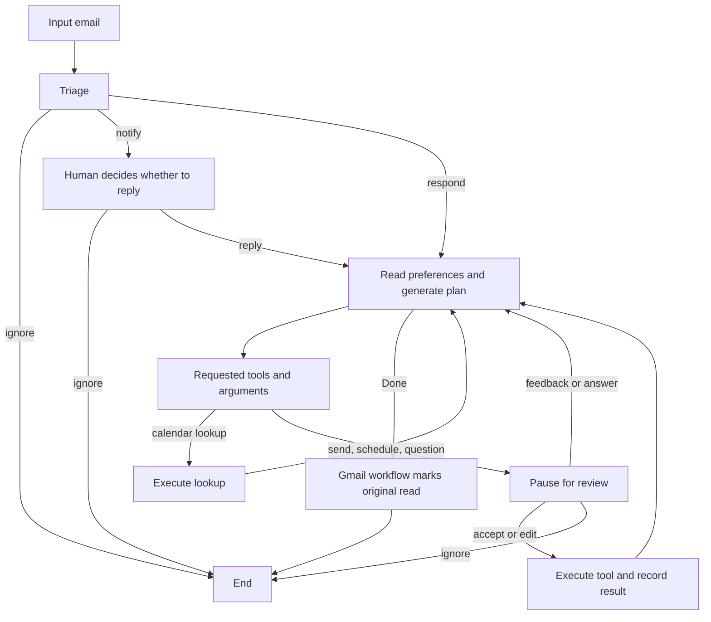

# MailFlow Agent

English | [简体中文](README.zh.md)

A LangGraph email-agent learning project combining DeepSeek, email triage, human review, preference memory, Gmail integration, and evaluation. It progresses from simulated tools and explanatory notebooks to a real Gmail workflow that pauses before sending a reply or creating a meeting.

The package is version `0.5.0`. The existing release records one dedicated test email completing **Gmail read → classification → reply generation → human approval → real send → mark original read**. This is a personal experiment, not an unattended production inbox service. Calendar, ingestion, and scheduling code are present, but their presence does not establish that all real-world scenarios or deployment paths have been verified.

Test counts and observations below are historical project records; this bilingual documentation update did not rerun tests, call models, or access Google APIs.

## Implemented capabilities

- Email triage into `respond`, `notify`, and `ignore` paths.
- Central DeepSeek configuration, structured classification, tool calls, and non-thinking requests.
- Tool-call, classification, and response-quality evaluation materials.
- Human review with accept, edit, feedback, and ignore actions; missing details can be requested through `Question`.
- Shared resume-input validation that interrupts again on invalid input, including the Gmail workflow.
- Preference updates from edits and feedback, shared across threads through a Store.
- Gmail OAuth setup, a read-only connectivity check, mail tools, and a workflow using real Google APIs.
- An explicit single-email manual-test entry point, state/verification commands, and memory snapshots.
- Eleven groups of manual test instructions, separated from records of completed verification.

## Workflow and review semantics



Generating tool arguments does not execute the action. `accept` executes the proposal. `edit` executes the complete replacement arguments and updates the relevant preferences. `response` records feedback, updates preferences where applicable, and generates a new proposal for review. Answers to `Question` enter the current thread without directly updating long-term preferences. A triage decision of `ignore` ends the workflow without automatically marking the email read.

## Requirements and installation

Python **3.11** is recommended; `pyproject.toml` supports **>=3.11,<3.14**. The model requires a DeepSeek key and support for the project's tool calls and non-thinking parameters. Gmail integration additionally requires Google API setup and user authorization.

In PowerShell:

```powershell
git clone https://github.com/Daredevil3210/mailflow-agent.git
cd mailflow-agent
py -m pip install uv
py -m uv python install 3.11
py -m uv sync --python 3.11 --extra dev --locked
Copy-Item .env.deepseek.example .env
```

Copy the template only when configuring a new checkout; preserve an existing `.env`. Select `.venv\Scripts\python.exe` as your IDE/Notebook interpreter.

Fill in a private DeepSeek key locally:

```dotenv
DEEPSEEK_API_KEY=replace_with_your_private_key
DEEPSEEK_MODEL=deepseek-flash
LANGSMITH_TRACING=false
LANGSMITH_PROJECT=mailflow-agent
```

`deepseek-flash` is the identifier in the repository template, not an availability guarantee. The model factory uses `ChatOpenAI` as a client for `https://api.deepseek.com`, sends `thinking.type=disabled`, and uses Chat Completions. Choose an account-supported model compatible with those requests.

LangSmith tracing is disabled in the template. For tracing or online evaluation, configure its key, project, and regional endpoint if required. Google authorization and the DeepSeek key are separate configurations.

## Start with the simulated demo

```powershell
.\.venv\Scripts\python.exe -X utf8 run_demo.py
```

This invokes the basic assistant with simulated email tools; it does not send real mail. The notebooks cover the basic agent, evaluation, human review, and memory, and are kept without execution outputs.

## Gmail setup and controlled manual use

See the detailed [Gmail configuration guide](src/email_assistant/tools/gmail/README.md) and [manual test guide](docs/GMAIL_MANUAL_TEST_GUIDE.md), both currently in Chinese.

1. Enable Gmail and Calendar APIs in a Google Cloud project.
2. Configure the OAuth audience/test users and create a Desktop app client.
3. Save the client JSON locally as `src/email_assistant/tools/gmail/.secrets/secrets.json`.
4. From the repository root, authorize and check access:

```powershell
.\.venv\Scripts\python.exe -X utf8 src/email_assistant/tools/gmail/setup_gmail.py
.\.venv\Scripts\python.exe -X utf8 src/email_assistant/tools/gmail/check_gmail_read.py
```

Authorization creates a local `.secrets/token.json` in the Gmail tools directory and requests Gmail modification and Calendar scopes. Keep credentials, tokens, and `.env` out of commits. The read check looks for `MailFlow-Read-Test` by default, prints limited email headers, and neither invokes a model, sends mail, nor changes labels.

Start the Gmail-only local development service and leave its terminal open:

```powershell
$env:PYTHONUTF8 = '1'
.\.venv\Scripts\python.exe -X utf8 -m langgraph_cli dev --config langgraph.gmail.local.json --no-browser --no-reload --allow-blocking
```

Check `http://127.0.0.1:2024/ok`, then open the Studio link printed at startup. The graph name is `email_assistant_hitl_memory_gmail`. `langgraph.json` loads the broader set of development graphs; registering a cron graph does not create a scheduled task.

Send a dedicated test email from another address you control to the authorized Gmail address, with a subject beginning `MailFlow-Test-`. In another terminal, replace both example addresses and submit the specific email:

```powershell
$senderEmail = 'sender@example.com'
$assistantEmail = 'assistant@example.com'
.\.venv\Scripts\python.exe -X utf8 src/email_assistant/tools/gmail/manual_test.py submit --subject MailFlow-Test-01-Edit --sender $senderEmail --recipient $assistantEmail
```

The helper selects a unique email matching subject, sender, and recipient. Open the resulting thread link and inspect the proposed action. In Studio's raw Resume input, this accepts and **executes the current action**:

```json
[{"type":"accept"}]
```

To request a revision and review the next proposal:

```json
[{"type":"response","args":"Please make this reply shorter and less formal."}]
```

Studio's JSON input differs from Agent Inbox's feedback field. `Question` normally allows only `response` or `ignore`. Agent Inbox can connect to the local service using the graph name above. Check the current action and arguments before approving a send or meeting; changing reply text does not change a meeting that has already been created.

Inspect workflow state, verify actual mail effects, and save a preference snapshot:

```powershell
.\.venv\Scripts\python.exe -X utf8 src/email_assistant/tools/gmail/manual_test.py status --subject MailFlow-Test-01-Edit
.\.venv\Scripts\python.exe -X utf8 src/email_assistant/tools/gmail/manual_test.py verify --subject MailFlow-Test-01-Edit
.\.venv\Scripts\python.exe -X utf8 src/email_assistant/tools/gmail/manual_test.py memory --save after-first-test
```

Submitting the same subject again returns the existing thread rather than creating a new run; use a new subject for a new test. The helper does not approve review requests automatically. Run records and memory snapshots remain in ignored `.local-backups/`. The manual guide supplies full email templates, replacement `edit` arguments, and expected outcomes.

## Preference memory and thread state

The checkpointer stores execution state by LangGraph `thread_id`; the Store holds preferences under namespaces and keys for reuse across threads. The three profiles are `triage_preferences`, `response_preferences`, and `cal_preferences`, each using the `user_preferences` key.

`get_memory()` initializes a missing profile. `update_memory()` sends the previous profile and feedback to the model, then overwrites the stored text with a complete replacement. It does not train model weights. Accepting alone does not update preferences; ignoring can update triage preferences, so inspect whether the inferred rule is too broad.

Notebook experiments use `InMemorySaver`/`InMemoryStore` and lose their in-memory state on kernel restart. The development service manages its own `.langgraph_api` data and does not automatically reuse notebook objects. Gmail threads describe email conversations; LangGraph threads describe workflow execution.

Studio Memory shows the current profile, not its history. Inspect system inputs to see which rules a model actually received, and keep snapshots for comparison. An earlier observation found that a saved “after 2 p.m.” preference still led to a 2 p.m. proposal. A successful memory write therefore does not establish that the model followed the preference; execution-time validation remains needed.

## Repository guide

- `run_demo.py`: one-email demo using simulated tools.
- `notebooks/agent.ipynb`, `evaluation.ipynb`, `hitl.ipynb`, `memory.ipynb`: progressive learning notebooks.
- `src/email_assistant/email_assistant.py`: basic agent.
- `src/email_assistant/email_assistant_hitl.py`: human-review variant.
- `src/email_assistant/email_assistant_hitl_memory.py`: preference-memory variant.
- `src/email_assistant/email_assistant_hitl_memory_gmail.py`: Gmail workflow.
- `src/email_assistant/models.py` and `human_review.py`: model setup and review validation.
- `src/email_assistant/tools/gmail/`: OAuth, read check, live tools, ingestion, and manual-test helpers.
- `src/email_assistant/cron.py` and Gmail `setup_cron.py`: scheduling reference entry points, not an enabled schedule.
- `tests/`: review, memory, Gmail setup/workflow/manual helper tests, and response evaluation.
- [Implementation roadmap](docs/IMPLEMENTATION_ROADMAP.md): planned work toward a personal daily assistant.
- [Release notes](RELEASE_NOTES.md): existing `0.5.0` scope and validation record.

## Provided checks and historical validation

Offline checks use mocked external clients and do not connect to model or Google APIs:

```powershell
.\.venv\Scripts\python.exe -X utf8 -m pytest tests/test_human_review.py tests/test_memory.py tests/test_gmail_setup.py tests/test_gmail_workflow.py tests/test_gmail_manual.py -q
```

The existing release records **48 passing offline tests**: 10 review-resume, 14 memory, 6 Gmail authorization/read, 13 Gmail workflow/tool, and 5 manual-entry tests. Coverage includes review-before-execution using checkpoints, edit/response/ignore behavior, Done routing, email encoding and read labels, exact selection, and repeat-submission protection. These mocked checks do not demonstrate real-model compliance or every Google API behavior.

Online-evaluation collection is provided separately:

```powershell
.\.venv\Scripts\python.exe -X utf8 -m pytest notebooks/test_tools.py tests/test_response.py --agent-module email_assistant --collect-only -q
```

The previous record reports 18 collectable cases. Running the evaluations beyond collection calls models and may upload traces. Earlier single-run learning experiments recorded classification accuracy of 13/16 and complete-response tests passing 14/16; these use different definitions and are not stable performance guarantees. The `0.5.0` release did not rerun online evaluations, and this documentation update did not rerun any of these checks.

The historical real-mail check confirmed a sent record, the original test email marked read, and workflow completion. No private message, account, message/thread/run identifier, or trace is published. The eleven manual case groups are instructions, not completed results. Real Calendar creation, invitation delivery, and cross-email preference compliance still require separate verification.

## Known limitations and next steps

- Calendar timezone handling can fail and return mock data. The current placement of `sendUpdates` also needs correction; event creation and invitation delivery require separate verification.
- Some tools fall back to simulated results. A send-tool path uses a placeholder recipient when the original message cannot be found and is unsuitable for general real-mail use.
- `run_ingest.py` uses a broad query, retains a deduplication TODO, and attempts to delete old runs. The manual helper uses an independent, exact-match path; automatic inbox takeover has not been enabled.
- Multi-tool resume/replay, timeout reconciliation, and duplicate send/meeting protection need further work.
- Upstream example personas and some older tool names remain in prompts. Adapt identity, signature, timezone, and working hours before personal use.
- Preferences need account isolation, scope, conflict handling, and execution-time validation; service-restart recovery needs verification.
- Scheduled tasks, a continuously running service, and hosted deployment were not enabled in the recorded release.

## Data, provenance, and license

Real email content goes to the configured model service; enabling tracing may also send it to LangSmith. `.env`, OAuth files, tokens, local databases, logs, memory snapshots, private screenshots, and backups stay local. The repository provides empty configuration templates and manual examples using `example.com`; course sample assets retain their original context.

The project began from [LangChain agents-from-scratch](https://github.com/langchain-ai/agents-from-scratch) and [Ambient Agents with LangGraph](https://academy.langchain.com/courses/ambient-agents). This repository documents DeepSeek adaptation, runtime debugging, review-resume improvements, Gmail integration practice, and learning notes built on that foundation.

Licensed under [MIT](LICENSE), preserving the upstream `Copyright (c) 2026 LangChain, Inc.` notice.
