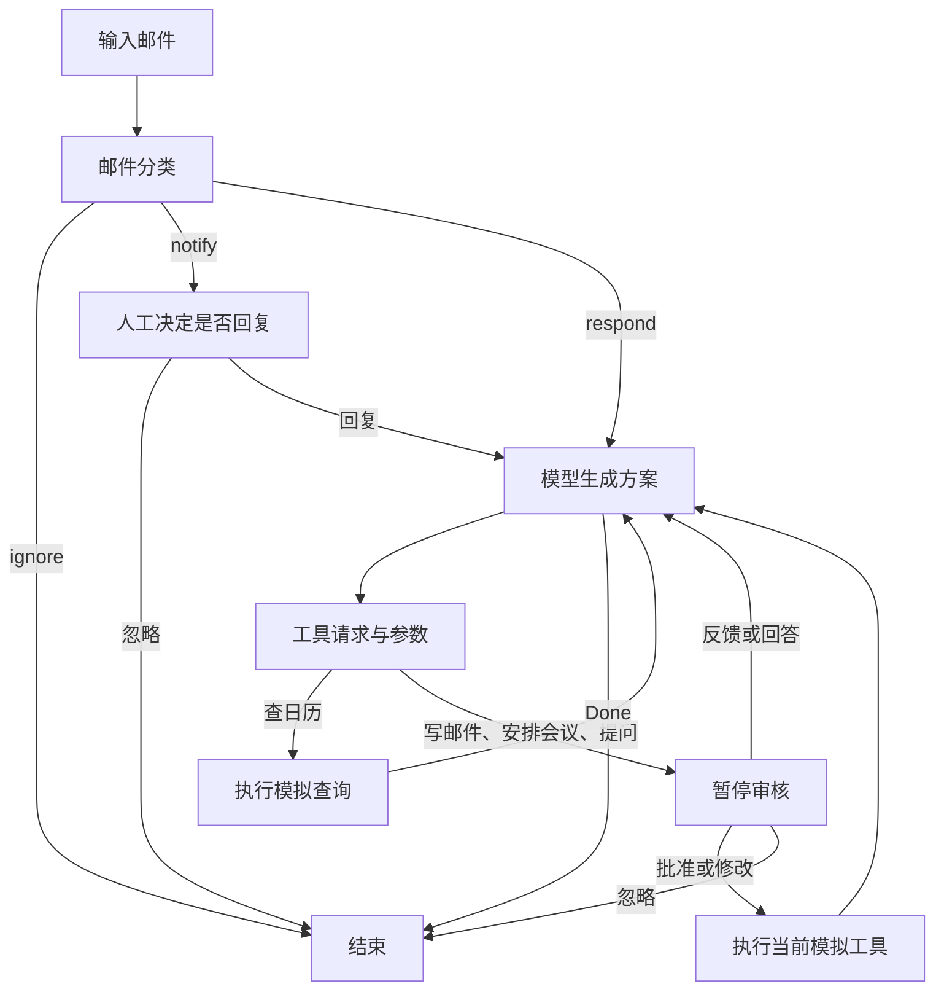

# MailFlow Agent｜邮件智能体学习项目

我用这个项目学习如何把大模型接入实际工作流：让助手判断邮件是否需要回复、选择工具完成任务，并在重要操作前暂停，交给我审核。

项目使用 LangGraph 编排流程，DeepSeek 负责分类和生成，LangSmith 用于追踪与评估。目前完成了基础邮件助手、评估实验、人工审核和偏好记忆模块。我把审核中的修改与反馈整理到 Store，让后续模型调用读取；也通过 Agent Inbox 完成了 API 文档邮件的问答，并进入邮件草稿审核。

邮件和日历工具目前都是模拟实现，适合学习与调试；真正接入邮箱服务是后续计划。

## 我完成的内容

- 邮件分类：区分 `respond`、`notify`、`ignore`，为不同结果安排后续节点。
- 工具调用：查询模拟日历、安排模拟会议、起草和模拟发送邮件。
- 人工审核：支持批准、修改参数、提出意见和忽略操作。
- 主动问答：助手通过 `Question` 获取缺失信息，再继续生成回复。
- DeepSeek 接入：集中管理模型配置，适配结构化输出、工具调用和非 thinking 模式。
- 评估实验：检查工具调用、分类结果，并使用模型裁判检查回复是否满足要求。
- Studio 调试：查看中断请求、提交 JSON 反馈、批准邮件、检查消息历史。
- 错误恢复：对人工审核输入做校验，格式错误时重新暂停，避免旧错误值让流程一直失败。
- 偏好记忆：用 namespace 和 key 管理分类、回复、日程偏好，从编辑或自然语言反馈中更新完整偏好文本。
- 跨线程复用：任务状态由 checkpointer 按 thread_id 保存；偏好由共享 Store 提供给不同线程。
- Agent Inbox：连接本地记忆工作流，回答 Question、查看 write_email 草稿，并区分接受与反馈的处理路径。

## 工作流程



模型先生成工具调用参数，包括邮件正文，程序再暂停供人工审核。`Question` 的回答由审核处理函数作为工具消息交回模型。

## 目录

- `notebooks/agent.ipynb`：基础 Agent 的学习与实验。
- `notebooks/evaluation.ipynb`：工具检查、分类评估和回复质量评估。
- `notebooks/hitl.ipynb`：人工审核、工具编辑、反馈和问答练习，以及实践记录。
- `notebooks/memory.ipynb`：Store 基础操作、偏好初始化与更新、接受/编辑/反馈对比，以及我的实践记录。
- `src/email_assistant/email_assistant.py`：基础邮件助手。
- `src/email_assistant/email_assistant_hitl.py`：带人工审核的邮件助手。
- `src/email_assistant/email_assistant_hitl_memory.py`：带偏好记忆的人工审核工作流。
- `src/email_assistant/human_review.py`：审核输入校验和恢复处理。
- `src/email_assistant/models.py`：DeepSeek 模型配置和环境变量加载。
- `tests/test_human_review.py`：无需模型 API 的审核恢复测试。
- `tests/test_memory.py`：使用模拟模型检查记忆读写、审核分支和跨线程复用。
- `tests/test_response.py`：工具调用与回复质量测试。
- `run_demo.py`：普通 Python 脚本入口。

仓库按当前学习进度维护。Gmail 和托管部署目前仅学习了概念，真实 Gmail 集成、定时任务和独立 LangGraph 101 教程暂未纳入。

## 本地运行

推荐 Python 3.11，项目支持 `>=3.11,<3.14`。克隆后在项目根目录的 PowerShell 中执行：

```powershell
py -m pip install uv
py -m uv python install 3.11
py -m uv sync --python 3.11 --extra dev --locked
```

在 PyCharm 中选择 `.venv\Scripts\python.exe` 作为解释器，Notebook 也使用同一个环境。

首次配置时复制模板；已有 `.env` 时不要覆盖：

```powershell
Copy-Item .env.deepseek.example .env
```

在自己的 `.env` 中填写配置：

```dotenv
DEEPSEEK_API_KEY=your_private_deepseek_key
DEEPSEEK_MODEL=deepseek-flash
LANGSMITH_TRACING=false
LANGSMITH_PROJECT=mailflow-agent
LANGSMITH_API_KEY=
```

模型名称可按账户支持情况调整，所选模型需要兼容工具调用和项目使用的参数。追踪与评估需要单独配置 LangSmith 密钥；使用其他服务区域时设置相应 `LANGSMITH_ENDPOINT`，必要时配置 `LANGSMITH_WORKSPACE_ID`。

```powershell
.\.venv\Scripts\python.exe -X utf8 run_demo.py
```

## 人工审核与 Studio

在项目根目录启动本地服务，并保持终端开启：

```powershell
.\.venv\Scripts\python.exe -X utf8 -m langgraph_cli dev --no-browser
```

打开启动信息中的 Studio 链接，选择 `email_assistant_hitl` 或带记忆的 `email_assistant_hitl_memory`。在 `email_input` 字段提交邮件对象，运行到中断后，在 Resume 的原始输入框提交 JSON。

回答问题或提出修改意见：

```json
[{"type": "response", "args": "Please make the email shorter and less formal."}]
```

批准当前方案：

```json
[{"type": "accept"}]
```

直接编辑邮件参数：

```json
[{
  "type": "edit",
  "args": {
    "args": {
      "to": "partner@example.com",
      "subject": "Re: Dinner?",
      "content": "Let's do Indian tonight!"
    }
  }
}]
```

每次先核对当前 `action`。会议参数不能提交给邮件工具，修改邮件正文也不会自动更改已经执行的会议安排。工具是否允许某种操作由中断请求中的 `config` 决定。

我排查过 `string indices must be integers, not 'str'`：处理函数原先直接按字典读取人工回复，错误字符串被检查点保存后，重试仍会拿到旧值。现在统一校验输入，并在错误格式下重新暂停；有效反馈能够从后续中断继续处理。

Notebook 使用 `InMemorySaver`，恢复时需要同一个图实例和线程编号；重启内核会丢失内存状态。本地开发服务把线程数据保存在 `.langgraph_api`，该目录不提交。查看消息历史时先重新获取状态：

```python
state = graph.get_state(thread_config)
for message in state.values["messages"]:
    message.pretty_print()
```

Agent Inbox 提供待办式审核界面。我使用图 `email_assistant_hitl_memory` 和服务地址 `http://127.0.0.1:2024` 连接本地服务，回答 API 文档邮件中缺失接口的问题，并进入邮件草稿审核。Response 输入框填写自然语言，Studio 的原始 Resume 输入框使用 JSON。接口沿用 `action_request`、`config`、`description` 协议。

Studio 用于检查执行节点、状态和错误；Agent Inbox 用于集中审核。一次审核中 Accept 与 Response 是两个选项：前者执行当前方案，后者让助手修改并等待下一次审核。若 Studio 显示 Failed to fetch，先打开 `http://127.0.0.1:2024/ok` 检查本地服务，并保持启动终端运行。

## 偏好记忆的实现与观察

我目前使用三份偏好：`triage_preferences` 决定哪些邮件需要处理，`response_preferences` 指导邮件风格，`cal_preferences` 指导会议安排。namespace 为 `("email_assistant", 偏好类别)`，每份文本使用固定 key `user_preferences`。

`get_memory()` 读取已有偏好；记录不存在时才初始化默认内容。`update_memory()` 将旧偏好、用户反馈或修改前后的参数交给模型，生成完整的新文本，再覆盖同一个 key。保存偏好不是训练模型参数。

不同审核操作的顺序不同：

- Accept：执行原方案，不根据接受动作更新长期偏好。
- Edit：执行编辑后的参数，再根据修改前后的差异更新对应偏好。
- Response：先记录反馈并更新偏好，模型读取后提出新方案，再次等待审核；当前方案不会在反馈时执行。
- Ignore：结束当前任务，课程实现会把该决定用于更新分类偏好；一次拒绝是否应该影响同类邮件，需要结合实际场景判断。
- 回答 Question：信息进入当前线程的消息，这个分支没有直接更新长期偏好。

在 Notebook 中，可以这样连接两类存储：

```python
from langgraph.checkpoint.memory import InMemorySaver
from langgraph.store.memory import InMemoryStore

checkpointer = InMemorySaver()
store = InMemoryStore()
graph = overall_workflow.compile(checkpointer=checkpointer, store=store)
```

换任务时创建新的 `thread_id`；若要沿用已学到的偏好，继续使用同一份 Store。Notebook 三组练习各自创建空 Store，是为了独立比较审核方式。内核重启后内存中的状态与偏好都会丢失；本地开发服务管理自己的存储，不会自动读取 Notebook 的 Store。

我可以在 Studio 的 Memory 中查看本地服务当前保存的偏好，也可以检查 Trace 中模型的 system 输入，确认当次使用了哪些规则。当前内容不等于每次历史调用的 Store 快照。

测试中需要同时检查记忆与实际参数：我观察到记忆已经是“下午两点之后”，模型仍可能给出 `start_time=14`。提示词中的偏好不是硬性校验，实际执行前仍需审核。修改邮件文字也不会自动调整已执行的会议。当前实现保留课程的字符串记忆结构与简单副作用处理；多工具审核恢复时的重复执行、偏好冲突、用户隔离和数据库持久化还需要继续完善。

## 测试与实验记录

无需外部模型的审核与记忆测试：

```powershell
.\.venv\Scripts\python.exe -X utf8 -m pytest tests/test_human_review.py tests/test_memory.py -q
```

覆盖结构化回复、非法输入恢复，以及记忆初始化、namespace 隔离、旧偏好与反馈输入、更新后读取、审核执行顺序、跨线程复用和 Done 路由。当前版本 24 项通过，其中审核恢复 10 项、记忆模块 14 项。记忆测试使用模拟模型和工具验证代码流程，不代表已经验证真实模型的偏好提取质量。

检查在线评估用例能否加载：

```powershell
.\.venv\Scripts\python.exe -X utf8 -m pytest notebooks/test_tools.py tests/test_response.py --agent-module email_assistant --collect-only -q
```

基础工具检查为 2 项，完整回复测试使用 8 封邮件，分别检查工具调用和回复质量，共 16 项：

```powershell
$env:LANGSMITH_TEST_SUITE = "MailFlow Agent: Tool Checks"
.\.venv\Scripts\python.exe -X utf8 -m pytest notebooks/test_tools.py -v

$env:LANGSMITH_TEST_SUITE = "MailFlow Agent: Response Evaluation"
.\.venv\Scripts\python.exe -X utf8 -m pytest tests/test_response.py --agent-module email_assistant -v
```

这些评估会调用模型，并记录到配置的 LangSmith 账户。此前单次学习运行中，分类评估为 13/16 正确，完整回复测试为 14/16 通过；两个指标测量的内容不同，不能视为稳定性能保证。本次发布未重新运行整套在线评估。

人工审核练习中已跑通会议与邮件参数编辑、晚餐偏好问答，以及 Studio 中对 API 文档邮件的反馈和批准流程。模型是否严格满足时间、语气等要求，仍需要结合具体输出检查。

## 后续计划

- 接入真实邮箱与日历，补充参数校验。
- 处理多工具请求及恢复重放中的副作用问题。
- 为偏好加入适用范围、冲突处理、用户隔离和持久化存储。
- 补充真实模型对偏好提取及遵循情况的评估，完善 Agent Inbox 的完整审核测试。

## 来源与许可

项目起步参考了 [LangChain agents-from-scratch](https://github.com/langchain-ai/agents-from-scratch) 和 [Ambient Agents with LangGraph](https://academy.langchain.com/courses/ambient-agents) 课程代码。我在此基础上进行 DeepSeek 适配、运行调试、审核恢复改进和学习记录整理。课程示例、公共辅助代码及插图保留其原始来源。

采用 [MIT License](LICENSE)，保留上游 `Copyright (c) 2026 LangChain, Inc.` 声明。
